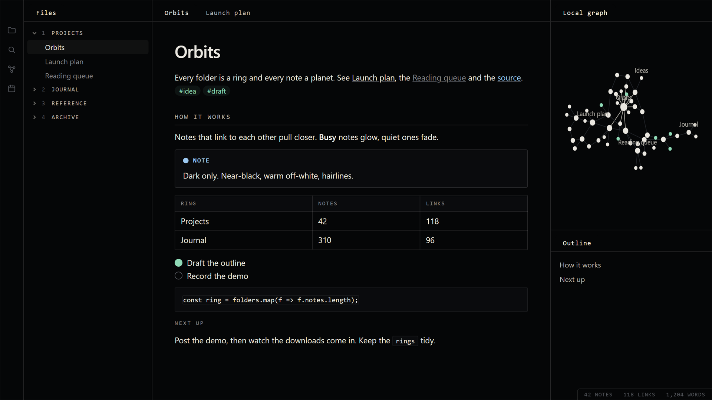

# Rho Zero

A dark theme for Obsidian: near-black, warm off-white, hairline panels and small spaced-out mono labels. Quiet, flat, no gradients.

## What it does

- **Colours:** near-black `#050607` background, warm off-white text, soft greys for everything in between.
- **Sections as labels:** `h2` and `h3` headings become small spaced-out mono capitals, the note title stays plain.
- **Hairlines:** tables, callouts and code sit in thin-bordered boxes with tight corners.
- **A menu-like sidebar:** top folders are numbered (`1 PROJECTS`, `2 JOURNAL`) in small mono capitals.
- **Soft status colours** for callouts, tags and highlights: mint, salmon, sand, lilac and sky.
- **Graph:** a dark field, warm white nodes, faint lines, mint tags.

Dark mode only. In Settings > Appearance, set the base colour scheme to Dark.

## Install

In Obsidian: Settings > Appearance > Themes > Manage, search for **Rho Zero**, Install and use.

Or by hand: from the latest release, download `manifest.json` and `theme.css` into `<your vault>/.obsidian/themes/Rho Zero/`, then pick Rho Zero under Settings > Appearance > Themes.

## Fonts

It asks for **Geist** and **Geist Mono** (free, by Vercel). If they aren't installed it falls back to your system's own sans and mono fonts and still looks fine; the screenshot above is the fallback.

## Goes well with

[Rho Network](https://github.com/clowsuzu/rho-network), a plugin that turns your vault into a living 3D star system. The two share a look, but neither needs the other.

## Licence

[PolyForm Strict 1.0.0](https://polyformproject.org/licenses/strict/1.0.0), see [LICENSE](LICENSE). Free to use for yourself and for any other noncommercial purpose. Selling it, passing copies on and publishing changed versions are not allowed. Your own tweaks in a CSS snippet next to the theme are fine.